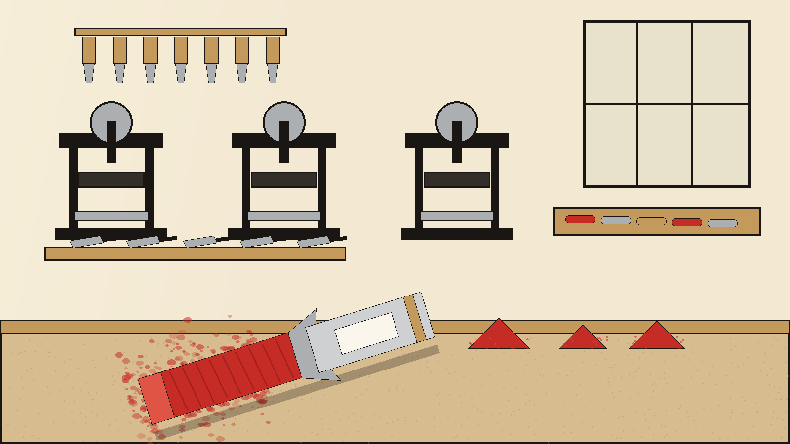
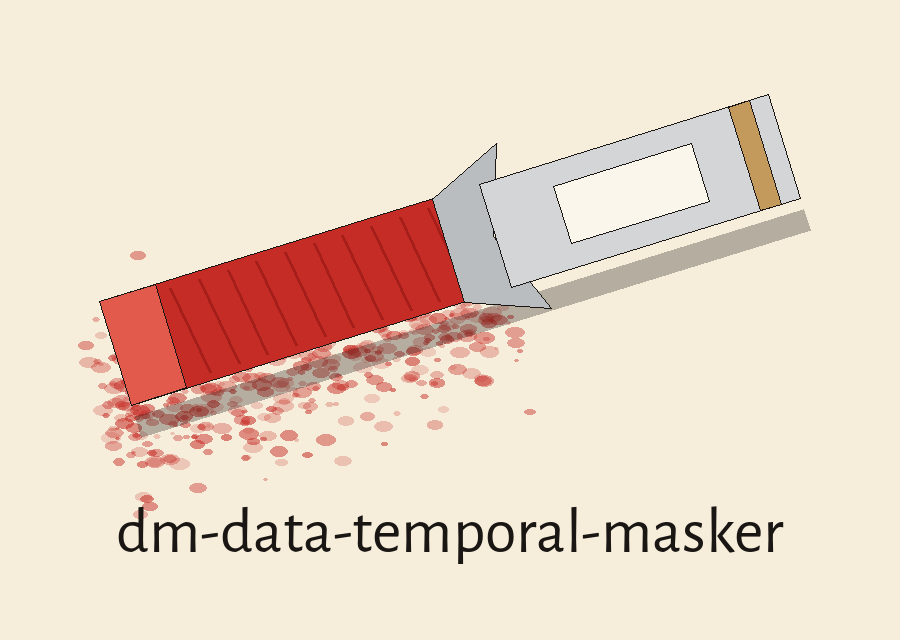
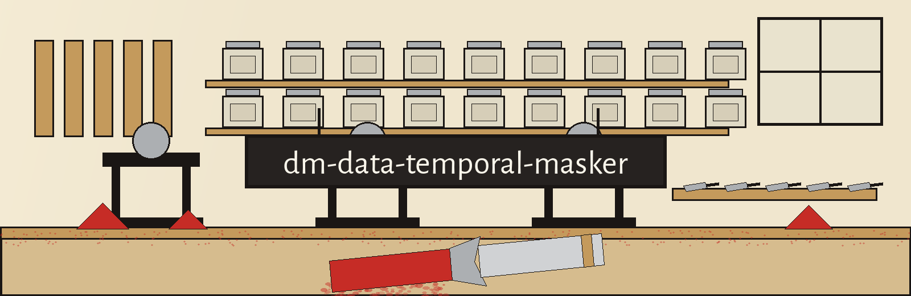
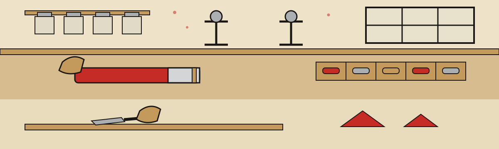

# dm-data-temporal-masker

Studio inventory entry, medium first: pastel stick on slab stone, the name above is set in Permanent Marker in print ink black, with a tiny jar sketch parked at the left of this title block and a stubby pastel stick, shrunk to punctuation size, marking each section below.

# dm-data-temporal-masker
Masks or modifies time-related data, such as timestamps or date ranges, while preserving temporal relationships (e.g., order of events, durations). Can shift time values by a random offset or bucket them into broader time intervals (e.g., days, weeks, months) while ensuring consistency across related records. - Focused on Tools designed to generate or mask sensitive data with realistic-looking but meaningless values

## Install
`git clone https://github.com/ShadowGuardAI/dm-data-temporal-masker`

> Studio inventory entry: the README clone line names the organisation without a hyphen, exactly as preserved here. The corrected spelling lives on the website, flagged as a correction.

## Usage
`./dm-data-temporal-masker [params]`

## Parameters
- `-h`: Show help message and exit
- `--shift_days`: No description provided
- `--bucket_interval`: No description provided
- `--input_file`: Path to the input file containing time-related data.
- `--output_file`: Path to the output file to write the masked data.
- `--date_format`: No description provided
- `--column_index`: No description provided
- `--randomize_time`: Randomize the time portion of a datetime object.

The output file must not be the input file. A run that names the same file for both, in any spelling that resolves to the same path, is refused at exit 1 before any file is opened. The input is read in full before any output path is opened in every run.

> Studio inventory entry: output must not be the input file.

> Studio inventory entry: the input is read in full before any output path is opened.

> Studio inventory entry: a time free format defeats --randomize_time.

> Studio inventory entry: a day bucket on a date only format changes nothing.

A run with --randomize_time whose date format has no time fields is rejected at exit 1, and a --bucket_interval day run on a date only format is rejected at exit 1, because neither can change a value. The shift is drawn from the range excluding zero and the drawn shift is logged on every shift run. An empty input exits 1, and a run that changes no dates exits 1 with a plain no dates were changed line and no complete log.

> Studio inventory entry: a run that changes no dates exits 1 with no complete log.

## License
Copyright (c) ShadowGuardAI

## Ground at the laboratory bench

The main button of this re-skin reads Mask the Times. Its input field label reads Input File. Its guard heading reads Output Never Equals Input. Its refusal heading reads Runs That Change Nothing Are Refused. It ends with the pastel stick pictured inside the finished artwork atop the easel, the grind room quieted, north light guttering gradually above the slab.
